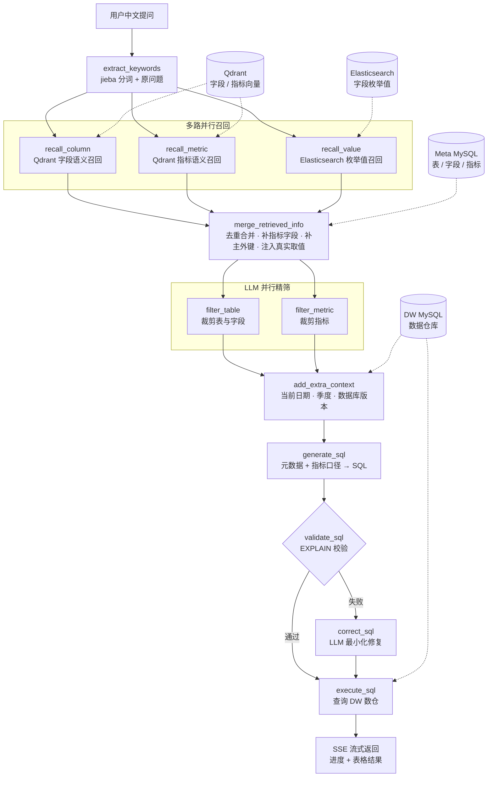

# 数仓智询 | 多源 RAG 驱动的可信 NL2SQL Agent

> `warehouse-query-agent`


数仓智询（`warehouse-query-agent`）是一款面向数据仓库的自然语言查询智能体系统（NL2SQL）。用户只需用中文提问，系统便能自动理解问题语义、召回相关元数据、生成并校验 SQL，最终执行数仓查询并返回结构化结果，全程无需手写 SQL。

“可信”体现在元数据约束、真实字段取值注入、`EXPLAIN` 校验和自动纠错；查询过程通过 SSE 实时展示，用户无需等待全流程结束才看到反馈。

## 它能做什么

- **自然语言查数**：例如「2025 年 Q1 各省份订单金额排名」。
- **理解业务语义**：识别 GMV、销售额、会员等级、商品品类等指标与维度。
- **多源 RAG 召回**：用 Qdrant 找字段和指标，用 Elasticsearch 找真实字段取值。
- **SQL 自动校验与修复**：先通过 `EXPLAIN` 验证，失败时让大模型基于错误信息校正一次。
- **过程可视**：每个 Agent 节点实时推送执行进度，最终结果以表格展示。

## Agent 工作流



三路召回和两路精筛均为并行执行。SQL 校验失败时只进入一次校正，校正后直接执行，不会形成多轮重试循环。

## 关键设计与架构亮点

### 1. 多源 RAG 检索策略

针对 NL2SQL 场景的三类不同语义对象，设计三套并行召回通道，精准覆盖不同召回需求：

| 召回目标 | 检索引擎 | 检索方式 | 关键技术 |
| --- | --- | --- | --- |
| 字段语义 | Qdrant 向量库 | 余弦相似度向量检索 | Embedding + 余弦相似度（阈值过滤） |
| 指标概念 | Qdrant 向量库 | 余弦相似度向量检索 | 指标名/描述/别名联合向量化 |
| 字段枚举值 | Elasticsearch | IK 中文分词全文检索 | `ik_max_word` 分词 + `min_score` 过滤 |

LangGraph 并行边实现三路并行召回，最大程度缩短检索耗时，显著提升系统吞吐能力。

### 2. 元数据驱动的知识库构建

系统维护两类存储：

- **Meta MySQL**：存储表、字段、指标的结构化元数据，包含字段类型、角色（主键/外键/度量/维度）、描述、别名和数据示例。
- **索引层**：通过 `build_meta_knowledge` 脚本将字段信息、指标信息批量向量化写入 Qdrant，并将字段值写入 Elasticsearch。

元数据与索引层分离设计，元数据变更后只需重新构建知识库，无需改动业务代码，具备良好的可扩展性。

### 3. LangGraph 状态图编排 AI Agent

项目使用 LangGraph `StateGraph` 对整个 Agent 工作流进行声明式编排：

- **状态管理**：`DataAgentState` 作为贯穿全图的共享上下文，各节点只读写自身关注的字段，避免数据竞争。
- **并行执行**：`extract_keywords → (recall_column ‖ recall_value ‖ recall_metric) → merge_retrieved_info`，天然支持并发。
- **条件路由**：`validate_sql` 根据校验结果动态路由至 `execute_sql` 或 `correct_sql`，实现 SQL 校正能力。
- **Context 注入**：通过 `DataAgentContext` 将数据库客户端、Repository 对象注入各节点，实现依赖解耦。

### 4. 体系化 Prompt 工程

所有 Prompt 外置为独立 `.prompt` 文件，分角色精细设计：

| Prompt 文件 | 角色定位 | 输出格式 |
| --- | --- | --- |
| `extend_keywords_for_column_recall` | 字段推断专家：推断回答问题必需的字段名 | JSON 数组 |
| `extend_keywords_for_metric_recall` | 指标语义扩展专家：生成指标召回关键词 | JSON 数组 |
| `extend_keywords_for_value_recall` | 业务语义解析专家：识别字段取值候选 | JSON 数组 |
| `filter_table_info` | 查询规划专家：裁剪必需的表和字段 | JSON 对象 |
| `filter_metric_info` | 指标筛选专家：确定必需的指标 | JSON 数组 |
| `generate_sql` | 资深数据库专家：NL → SQL | 纯文本 SQL |
| `correct_sql` | SQL 调试专家：最小化修复 SQL | 纯文本 SQL |

每个 Prompt 均包含角色设定（Role）、任务说明（Action）、严格的生成规则（Format）和禁止事项，有效约束 LLM 输出格式，降低幻觉风险。

### 5. 全异步高并发架构

- **框架层**：FastAPI + Python asyncio，全异步 HTTP 服务。
- **数据库层**：SQLAlchemy `AsyncSession`（代码实际使用 `asyncmy` 驱动），异步操作 Meta MySQL 和数据仓库 MySQL。
- **向量库层**：`AsyncQdrantClient`，异步向量检索。
- **ES 层**：`AsyncElasticsearch`，异步全文检索。
- **LLM 层**：LangChain `ainvoke`，异步调用大语言模型。

所有 I/O 操作均为非阻塞，配合 LangGraph 并行节点，系统在高并发查询场景下具备良好的吞吐性能。

### 6. 流式输出与进度实时反馈

- 每个 Agent 节点通过流写入器 `stream_writer` 实时推送 `{type: progress, step, status}` 进度事件。
- 最终查询结果以 `{type: result, data}` 事件流式写入前端，用户无需等待全流程完成。
- LangGraph `astream` 支持 `custom` 流模式，前端基于 SSE 协议实时展示各阶段处理状态，提升交互体验。

## 技术栈全景

| 层次 | 技术组件 | 作用 |
| --- | --- | --- |
| API 服务 | FastAPI | 异步 HTTP 服务框架，提供查询接口 |
| Agent 编排 | LangGraph | 状态图编排，管理多节点 AI Agent 工作流 |
| LLM 调用 | LangChain + 大语言模型 | Prompt 管理、LLM 调用链、输出解析 |
| 向量检索 | Qdrant | 字段语义 & 指标向量相似度召回 |
| 全文检索 | Elasticsearch + IK 分词 | 字段枚举值中文全文检索 |
| 关系数据库 | MySQL（Meta DB） | 存储结构化元数据（表/字段/指标信息） |
| 数据仓库 | MySQL/Hive（DW） | 存储业务数据，执行最终 SQL 查询 |
| 中文分词 | jieba | 用户问题关键词提取 |
| 向量化 | BGE-large-zh-v1.5 | 文本向量化，支持语义相似度检索 |
| 异步 ORM | SQLAlchemy AsyncSession | 异步操作 MySQL 数据库 |

当前仓库的 Compose 与配置提供 MySQL 数仓实现；前端示例使用 Vue 3 + Vite。

## 项目结构

```text
.
├── app/
│   ├── agent/          # LangGraph 图、状态、12 个节点与 LLM
│   ├── api/            # FastAPI 路由、依赖项、请求模型
│   ├── clients/        # MySQL / Qdrant / ES / Embedding 客户端
│   ├── repositories/   # 各数据源的持久层
│   ├── services/       # 查询编排与元数据知识库构建
│   ├── scripts/        # build_meta_knowledge 构建脚本
│   └── conf/           # 配置加载
├── conf/
│   ├── app_config_example.yaml
│   └── meta_config.yaml
├── docker compose/     # MySQL、Elasticsearch + IK、Kibana、Qdrant、Embedding
├── front/              # Vue 3 对话式查询前端
├── prompts/            # 外置 Prompt 模板
└── main.py             # FastAPI 入口
```

## 本地运行

### 1. 准备环境

需要 Python 3.12+、[uv](https://docs.astral.sh/uv/)、Docker Desktop，以及 Node.js 22+（仅前端）。

```powershell
uv sync
```

### 2. 启动基础服务

```powershell
cd "docker compose"
docker compose up -d --build
```

启动后可使用以下端口：

| 服务 | 地址 |
| --- | --- |
| MySQL | `localhost:3307` |
| Elasticsearch | `http://localhost:9200` |
| Kibana | `http://localhost:5601` |
| Qdrant | `http://localhost:6333` |
| Embedding 服务 | `http://localhost:8081` |

首次启动需要等待 MySQL 初始化 `meta`、`dw` 两个库，以及 Elasticsearch 加载 IK 插件。可以通过 `http://localhost:9200` 确认 ES 已就绪。

### 3. 配置应用

```powershell
Copy-Item conf\app_config_example.yaml conf\app_config.yaml
```

编辑 `conf/app_config.yaml`，重点确认：

- `db_meta.port` 与 `db_dw.port` 填 `3307`，因为 Compose 将 MySQL 映射到宿主机 `3307`。
- 数据库用户与密码和 `docker compose/docker-compose.yaml` 保持一致。
- `qdrant`、`embedding`、`es` 使用本机地址。
- `llm.api_key` 填入可用的模型 API Key。

`conf/app_config.yaml` 已被 `.gitignore` 忽略，请勿提交密钥。

### 4. 构建元数据知识库

```powershell
uv run python -m app.scripts.build_meta_knowledge -c .\conf\meta_config.yaml
```

该步骤会读取数仓字段类型与样例值，将元数据写入 MySQL，同时建立 Qdrant 向量索引和 Elasticsearch 全文索引。修改 `meta_config.yaml` 或数仓结构后需要重新执行。

### 5. 启动后端

```powershell
uv run fastapi dev main.py
```

接口文档：`http://127.0.0.1:8000/docs`

### 6. 启动前端

```powershell
cd front
npm install
npm run dev
```

Vite 已将 `/api` 代理到 `http://localhost:8000`。

## 接口示例

```powershell
curl.exe -N -X POST http://127.0.0.1:8000/api/query `
  -H "Content-Type: application/json" `
  -d '{"query":"2025 年 Q1 各省份订单金额排名"}'
```

响应为 SSE 流：

```text
data: {"type":"progress","step":"抽取关键字","status":"running"}

data: {"type":"progress","step":"抽取关键字","status":"success"}

data: {"type":"result","data":[{"地区":"华东","订单金额":107373.0}]}
```

当前示例数据覆盖 2025 年 Q1，可以尝试：

- 2025 年 Q1 总订单金额是多少？
- 2025 年 1 月各省份订单金额排名
- 黄金会员购买苹果品牌产品的总数量
- 2025 年 2 月各产品品类的订单金额

## 说明

- 项目会执行大模型生成的 SQL。生产环境应使用只读数据库账号，并增加 SQL 白名单、超时和结果行数限制。
- 当前流程最多自动校正一次；若修正后的 SQL 仍不可执行，流会在 `execute_sql` 节点中断，错误写入服务日志。
